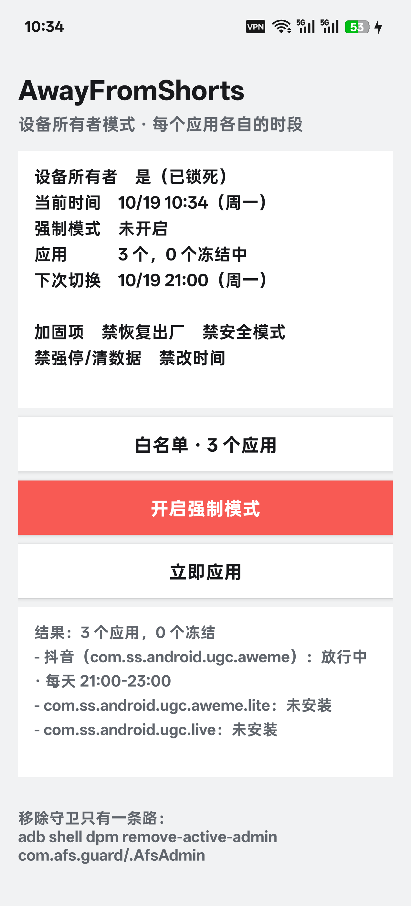
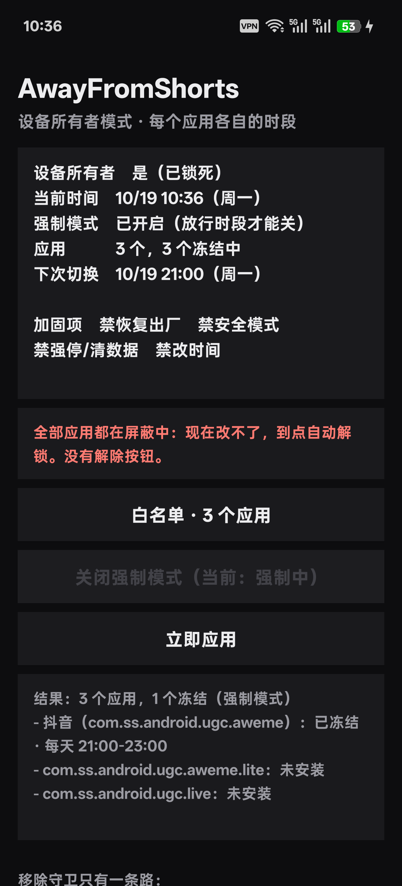
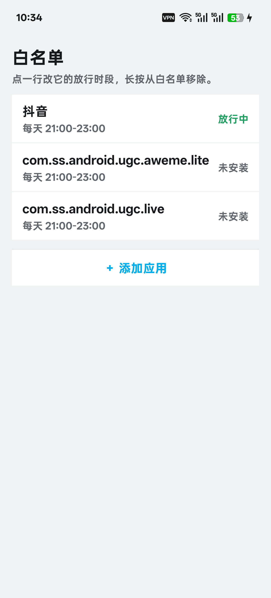

# AwayFromShorts · Android 端 📱

## 当前开发版 1.91.19

本地开发版与下方GitHub正式发行版分别标注；下载正式包以Release实际发布内容为准。

1.91.19（真机 1.91.19）：定时提醒的弹窗**前 15 秒关不掉**——返回键、点卡片外面、点卡片本身在这 15 秒里一律无效，想跳过只能等它走完。「消失方式」保留，它只管 15 秒**之后**是自动退场还是继续等人点；「开启提醒」开关照旧可以关。

1.91.17：新增运维指令通道 `files/afs-command.json`，节拍里发现就执行（按格子改额度分钟数、按包名批量改冻结时段），执行完改名 `.applied`。起因是这台 ROM 杀不掉守卫进程（`am force-stop`/`stop-app`/`pm disable-user` 全部静默失败，它是 active device admin），而 SharedPreferences 在进程内是缓存、每 5 秒还会被账本写回，所以直接改 XML 永远不生效。有了这条通道，调数值不用再为了一次改动发版。

1.91.16：跨设备共享格子的分钟数改成**跟着电脑端走**。池子的预算本来就只有 PC 一个权威（`game-quota-config.json` 里那条 shared 规则），手机本地那份 minutes 只是显示用的副本，以前两边各存各的；现在每次轮询拿到 `poolMinutes` 就对齐，电脑把池子改成 90，手机不会再顶着 120。

1.91.14（真机当前为 1.91.13，同一份代码）：定时提醒卡片默认改为**15 秒后自动消失**，不再需要点「知道了」：轻提醒不该等人腾出手来点。设页新增「消失方式」，可以切回「点一下才消失」（老行为，卡片一直留着等人确认）。自动消失模式下卡片上不摆任何按钮热区，想提前关掉点卡片外面或按返回。

1.90.6：修「Google Play 时间限额锁不住」的真正原因 —— **这台 ROM 不允许挂起 Play 商店**。实测：额度超额时 Chrome 冻上了（suspended=true），Play 商店却被系统拒绝（suspended=false），所以昨天池子用了 164 分钟、额度 120 分钟照样能用。现在挂起被拒时自动退到「隐藏」：图标从桌面消失、点不开，效果和冻结一样，放行时恢复显示（结果页写「已冻结（隐藏）」）。同时修掉隐藏带来的连带问题：被隐藏的应用在普通查询里和「已卸载」一样查不到，会导致额度清理把它当卸载删掉（实测配置直接丢）、结果页只剩包名；现在改用 `MATCH_UNINSTALLED_PACKAGES` + `FLAG_INSTALLED` 判断，名字也能正常显示。

1.90.3：修「Google Play（及其他应用）时间限额锁不住」暴露出的两处：①**读使用记录改成按小时分块查询**——额度日从早 8 点起算，所以每天 0 点到 8 点这段查询窗口有 22 小时，一次查完会超过单次调用的传输上限被截断，而且丢掉的是**最新**的事件，于是正在用的时候额度不涨、限额永远不触发；②**冻结结果如实上报**——系统拒绝 suspend 时，`setPackagesSuspended` 是通过返回数组告诉你哪些包没冻上，原来完全不看这个返回值，拒绝时界面照样显示「已冻结」，用户只看到锁不住却以为已经冻上了；现在会明确写「冻结被系统拒绝」。

1.89.2：修「时间额度统计漏记」——真机上 Telegram 看了近 90 分钟，额度只记了 1.9 分钟（微信、Chrome 同样只记了十分之一）。两个根因：①读使用记录时查了 7 天窗口，事件量一大系统会截断并丢掉最新事件，正在用的时候账本反而不动；②账本按「每次刷新的时间窗口」增量累加，任何一次刷新失败/进程重启，那一小段就永久丢失。现在只查当天，并改成每次按今天的用量区间重算（只升不降、自愈），实测把当天漏掉的用量全部补回，超额格子随即正常冻结。

1.89.1：打卡罚时覆盖到「所有被冻结的应用」（原来只落在关联动的一部分上）：20:00 打卡没完成，各冻结应用在今天的放行点后继续冻结 30 分钟。修掉两个让罚时「看起来没生效」的原因：①规则里只要有一段跨午夜冻结（如 00:00-21:00 + 23:00-24:00）就整条跳过 → 改为只看放行点是否在今天；②罚时判定排在「钥匙应用/非联动放行」之后会被直接放行 → 改为先于该豁免判定。冻结原因文案「禁忌延长冻结」统一为「延长冻结」。

1.88.0：使用限额「挂后台也计时」口径修正：切到后台后**还在跑**（音乐播放、画中画这类前台服务在运行）才继续计时，关掉就停；切走闲置、应用已关闭都不计（1.87.0 的「打开就计到额度用完」作废）。锁屏、灭屏不打断挂后台的计时；与前台重叠的部分合并成一段，不双倍计。

1.87.0：使用限额新增「挂后台也计时」，按应用勾选；新增勾选随时可做，取消要等调整时段（口径已在 1.88.0 修正）。

1.86.0：卡面有英文时新增「英音 / 美音」发音按钮（系统 TTS，不联网，缺对应语音包会明说，不静默失败）；子页面不再挂底部标签栏 —— 卡管理里的记忆卡设置、统计曲线、卡片编辑器、刷题练习页，以及从卡管理进的目标卡、禁忌卡、外观字体都不再出现主标签栏，只有五个主标签的首页保留。

1.85.0：记忆卡改纯手势评分 —— 第一次上滑＝认识直接翻下一张，第一次下滑＝忘了，点卡片＝完全不认识，后两者先揭晓答案、之后只能上滑进入下一张；删除「显示答案」与「忘了 / 费力 / 记住 / 轻松」四个按钮，卡面下方不再有说明文字；评分改在揭晓之前落盘。

1.83.1：底栏统一按实际窗口位置和系统导航区域计算内容安全间距，移除分散的固定94dp留白，覆盖五个主页面及使用限额页；键盘出现时隐藏底栏，按实际可见区域避让。修复使用限额页首次打开的空控件崩溃。

1.79.5：成就解锁加入一次性徽章完成动画；App冷启动改为标志旋转归位与淡出，正常动画时长约440ms。使用原生View、统一曲线与时长，支持减少动态效果、系统动画关闭、页面离开清理。API34动效专项13项与离线回归通过；不修改成就判定或已解锁记录。

1.79.3：备份与恢复集中到设置 → 数据与备份；移除打卡、记忆和备忘录重复入口，明确白名单备份与全局镜像的区别。

1.79.2：移除涟漪风格，旧配置自动回退原有风格，保留颜色、深浅色和字体等其他设置。

1.79.1：定时休息提醒到点弹出可关闭的提醒页面，关闭后返回原界面；通知保留为再次打开提醒的入口。通知权限关闭不影响页面启动。设备所有者模式可后台弹出，普通安装需在定时提醒里授权“后台提醒弹窗”。灭屏、锁机和放行期的免打扰规则不变。API34模拟器13项弹窗专项与完整离线回归通过，PLR110已升级验证版本号。

Windows解压完整部署包后双击“开始安装.cmd”打开图形向导：选择手机 → 检查条件 → 安装或保留数据升级 → 验证运行。既有设备所有者授权会保留；首次启用设备管理需阅读并勾选确认。受账号、分身或其他管理者阻挡时明确停止，不自动清机或删除账号。原命令行参数继续支持，详见[部署与使用](docs/DEPLOYMENT-AND-USABILITY.md)。

手机采用打卡、记忆、守卫、刷题、冻结五个底栏页面。冻结页以时段和额度管理应用，点任意应用进入统一详情，可查看冻结原因、安排时段、调整额度、查看断网状态和修复缺失权限。设置与同步入口在守卫 → 卡管理。旧版本截图和性能记录仅代表对应历史版本。


**最新正式版：[v1.79.2](https://github.com/sdgfdii/AwayFromShorts-Phone/releases/tag/v1.79.2)**。提供正式签名APK、图形向导Windows部署包及源码包。包含提醒页面弹窗、涟漪风格移除、冻结页局部刷新与资源优化。详见[发行说明](dpc/release/notes/1.79.2.md)和[部署与使用](docs/DEPLOYMENT-AND-USABILITY.md)。

> 到点把短视频 App **真的锁住** —— 不是弹个提醒,是点不开。

Windows 那套(hosts 屏蔽网站 + 杀进程 + 网页面板)在 **[AwayFromShorts](https://github.com/sdgfdii/AwayFromShorts)**,
是独立的另一个仓库。这里只有安卓。

---

**冻结页性能优化（1.49.3）**：应用目录后台读取、应用卡片按可视范围创建，时间轴改为按时段边界计算。同机首次打开 437ms → 137ms；完整指标与限制见 [性能记录](docs/PERF.md)。

## 两个方案

**卡管理与热爱奖励（1.53.0）**：守卫新增「卡管理」，集中热爱、记忆、刷题、目标、禁忌、总结六类卡的设置。热爱奖励每天最多一张、单次最多 60 分钟，可累计并自动抵扣定时冻结；总结支持自定义周期，逾期跨周期仍需补完。完整规则与验证范围见 [卡管理说明](docs/CARD-MANAGEMENT.md)。

**新增内嵌记忆学习（Device Owner 版）**：英语、医学、工科卡组，FSRS 间隔复习、输入自测、图片遮挡、错题重学、离线备份；可选择参与学习联动，打卡页展示进度卡，实际学习在记忆页完成。用法、开源来源与验证范围见 [记忆学习说明](docs/MEMORY.md)。

**主题设置（1.45.0）**：在「守卫」右上角进入，支持系统深浅色、纯黑、自定义配色、悬浮或固定底栏、三档液态玻璃、切页动画、字体搜索与文字缩放，见 [主题设置说明](docs/THEME.md)。

**可选高德风格（1.46.0）**：主题页新增界面风格切换，重点采用简洁线条图标和清晰的底栏选中态，保留原有风格与配色。见 [高德风格说明](docs/AMAP-STYLE.md)。

**全局瑞士排版（1.47.0）**：统一全部页面的字体层级、行距、页面边距与左对齐网格，同时调细高德风格图标。见 [排版说明](docs/SWISS-LAYOUT.md)。

**备忘录（1.48.0）**：首页「功能」新增速记入口，标题 + 正文可置顶、搜索、删除，存在本机不联网，深浅色与高德风格自动跟随。见 [备忘录说明](docs/MEMO.md)。

**工具箱（1.49.0）**：首页「功能」第四格，内含计时器（正/倒计时）、随机抽签和文本工具（字数、大小写、去重、排序）；全部离线、零新增权限。见 [工具箱说明](docs/TOOLBOX.md)。

**左右滑切页（1.50.1）**：底栏五个页面支持左右滑动切换，和点底栏走同一条切页过渡；闪卡滑卡、横向选卡条会优先接管手势，不互相抢。滑动阈值与冲突规则见源码 `SwipeNavHost` 注释。

| | **Device Owner**(`dpc/`) | **无障碍版**(`blocker/`) |
|---|---|---|
| 拦法 | 系统级冻结,图标变灰,点开提示"已暂停" | 一进前台就送回桌面 |
| 强度 | ✅ **真的锁死**:恢复出厂按钮变灰、强停/卸载点不动、安全模式进不去、改系统时间也没用 | ⚠️ 能拦,但你随时能在设置里关掉 |
| 重启后 | 照常生效 | 自动恢复 |
| 需不需要电脑 | 装的时候要,之后不要 | **完全不要** |
| 前提 | 设备必须**无账号 + 只有一个用户** | 装完即用 |

**能装 DO 就一定装 DO。** 无障碍版是退路 —— 当机器卡在"应用分身"残留的多用户上、设不上 DO 时才用它。

  

冻结中的应用按规则限制移动与修改，页面显示具体原因；应用库保留全部应用，可长按拖入／拖回时段。

---

## 一、Device Owner 版(推荐)

### 一键部署

```bash
cd dpc
bash deploy.sh
```

脚本会先自检三个硬条件(**无账号 / 单用户 / 无已有 Owner**),不满足会直接告诉你卡在哪、怎么解。

装不上的机器先看 [`dpc/COMPATIBILITY.md`](dpc/COMPATIBILITY.md) —— **90% 的情况是"应用分身"留下的第二个用户**
(`Type: profile.CLONE`,user 999)。删掉克隆应用、重启都清不掉它,只能从系统 UI 里关掉分身空间或恢复出厂。
真机 PLR110(ColorOS 16 / Android 16)就踩过这个坑,恢复出厂后才设上。

**装完必须让它被叫醒**:`pm install -r` 之后 App 处于 stopped 状态,系统广播根本送不进去。
`deploy.sh` 里已经固化了 `am broadcast --include-stopped-packages -a com.afs.guard.WAKE`
这一步,并会校验闹钟真的排上了 —— 手动 `adb install` 的人别漏掉。

### 在手机上是什么样

- 首页是一张运行状态卡 + 「功能」四格(卡管理 / 打卡历史 / 备忘录 / 工具箱),点状态卡看详情
- **1.49.1 起切页更轻**:只动新页面、玻璃着色器进程内复用、主题解析有缓存;细节和真机测帧方法见 [切页优化说明](docs/PERF.md)
- **打卡页就在这个 App 里**(不再单独装一个):一屏一张竖卡,往上推 = 打卡,
  左右推 = 换目标,长按改这一笔的数量。打完最后一笔会**当场解除**学习联动延长冻结
  —— 不用等 PC 每 15 分钟那趟同步。细节见 [`dpc/CHECKIN.md`](dpc/CHECKIN.md)
- 冻结页按时段、独立／共享额度管理应用；点应用进入统一详情，长按可拖动
- **移出与放宽限制按收束时段开放**：刚加 10 分钟内或首次宽限期可纠正误操作
  —— 防的就是"先移出来再放宽时段"这条绕路

### 重构时最该看的三处

| 文件 | 说明 |
|---|---|
| `dpc/java/com/afs/guard/Guard.java` | `blocked(Rule, Calendar)` 是**唯一**判定入口;加固开关(`BLOCK_FACTORY_RESET` 等)在文件顶部 |
| `dpc/java/com/afs/guard/Rule.java` | `days` 位图 + `windows[][]`,跨午夜靠逐分钟扫 |
| `dpc/java/com/afs/guard/RuleStore.java` | 规则落在 App 私有目录,旧格式 `{d,s,e}` 自动迁移 |

---

## 二、无障碍版(不需要 DO)

```bash
cd blocker && bash build.sh          # 产物 blocker/afs-blocker.apk
# 或者直接用仓库根的 afs-blocker.apk
```

装好后在系统里开无障碍服务:

```bash
adb shell settings put secure enabled_accessibility_services com.afs.blocker/com.afs.blocker.BlockerService
adb shell settings put secure accessibility_enabled 1
```

⚠️ 三个坑:

1. `adb install -r` 会**清掉** `enabled_accessibility_services`,每次升级都要重开
2. 服务要**首次解锁后**才绑定,锁屏时查不到进程是正常的
3. 踢回桌面成功后必须把内部 `lastPkg` 置空,否则 3 秒巡检会反复按 Home(桌面被顶)

详见 [`blocker/README.md`](blocker/README.md)。

---

## 为什么这么复杂

手机上没有任何"网站屏蔽"能拦住抖音 App 本身 —— hosts / DNS 对原生 App 基本无效,
能做的只有在**系统层面**把 App 冻住。而"到点自动冻"这件事在国产 ROM 上非常难:

- **ColorOS 会把闹钟整体推后 ~3 天**(`dumpsys alarm` 里 `adjustment=+2d23h58m`,连支付宝的闹钟一样被推)
- 灭屏进 Doze 后 `Handler.postDelayed` 直接被冻住(实测灭屏 70 秒才 tick 一次)

所以 v1.8.0 之后是**四件套**一起上:

1. 双路闹钟 `setAlarmClock` + `setExactAndAllowWhileIdle`(快路径)
2. `JobScheduler` 每 15 分钟兜底
3. `GuardService` 前台常驻,30 秒 tick
4. **常驻 `PARTIAL_WAKE_LOCK`**(tag `afs:guard`,无超时)—— 灭屏 CPU 不睡,tick 才跑得准

`deploy.sh` 还会把包加进 **Doze 白名单**(`dumpsys deviceidle whitelist +com.afs.guard`)。
光有 wakelock 挡不住系统级 Doze,两个缺一不可。

> 🔋 **代价是持续耗电。** 锁不设超时,服务活着就一直持着。这是拿电量换准时 ——
> 不这么干,到点根本不动。想省电就只能接受"晚几小时才切"。

---

## 自己构建

**不用 Gradle。** 只要 SDK 里的 `build-tools`、`platforms/android-34` 和 JDK 17:

```bash
export AFS_SDK=/path/to/android-sdk
bash dpc/build.sh       # → afs-guard.apk
bash blocker/build.sh   # → blocker/afs-blocker.apk
```

手工链:`aapt2 compile → link → javac(-source 8) → jar → d8 → 塞 classes.dex → zipalign -p 4 → apksigner`。
Git Bash 里没有 `zip`,脚本会用 Python 的 `zipfile` 追加写入 dex。

> **token 默认不注入。** 打卡要写 Gist 得有个只授 `gist` 权限的 token,
> 而 APK 里 grep 得到 `gho_` 前缀 —— 所以仓库里这份 APK 是**不带 token** 的公开构建,
> 装完第一次用打卡时长按标题「打卡」粘一次即可(存在 App 私有目录里)。
> 想出"装上就能打卡"的包:`echo "<token>" > dpc/token.local && AFS_PREFILL=1 bash dpc/build.sh`。
> `token.local` 和产物都别外传。

签名库在 `dpc/keystore/afs.keystore`(密码 `afsguard`)。**换 key 就无法覆盖升级**,自己编译就自己生成一个并保管好。

> ⚠️ `build.sh` 内部的 `grep -v warning` 会顺手吞掉 javac 的错误。构建"成功"但 APK 只有 12KB,
> 就是编译其实失败了。装之前先验:`aapt2 dump badging afs-guard.apk | grep versionName`(正常体积 7–8MB)。

> ⚠️ **别用 `aapt2 link -A assets`**:它在 Windows 上会把子目录写成反斜杠(`assets/fonts\xiaowei.ttf`),
> Android 的 AssetManager 按 `fonts/xiaowei.ttf` 找不到 —— 打卡页选内置字体会直接崩、刷题页 KaTeX 也加载不了。
> `build.sh` 现在改为链接后由 python 重新打包 assets(保证 zip 里全是 `/`)，自己改构建流程时别把这步删了。

## 回归测试

```bash
bash dpc/test/run.sh        # 11 组纯 Java 断言（含备忘录 63、工具箱 52 项）,不需要手机
bash blocker/test/run.sh    # 27 项
```

对拍的是"暴力逐分钟扫描"的结果 —— 跨午夜、多段时段、增删段的不可变性都在里面。

---

## 逃生口

```bash
cd dpc && bash uninstall.sh                                   # 正规拆除
adb shell dpm remove-active-admin com.afs.guard/.AfsAdmin      # 手拆
```

设备所有者一旦设上,**恢复出厂设置会被禁用**。这不是 bug,是 Device Owner 的本来面目。

## 还剩什么洞

诚实列一下,改代码也堵不掉:

1. **手机连着电脑就能拆** —— 一条 `dpm remove-active-admin`。数据线收起来。
2. **Web 版抖音**默认不管。要管就在 `Guard.java` 里开 `ALSO_SUSPEND_BROWSERS`。
3. **时区**:禁止手动改时间拦得住,出差自动换时区拦不住。
4. **无障碍版**天生能被用户在设置里关掉 —— 这就是它便宜的原因。

## License

[MIT](LICENSE)

## 手机独立插件（R2）

屏幕使用统计现可独立安装更新；首版仅官方签名，其他业务保留原实现。见 [插件安装与回退](docs/PLUGINS.md)、[实际验收与限制](docs/PLUGIN-R2-VALIDATION.md)。本地交付目录为 `dist/plugins-1.90.0/`。
