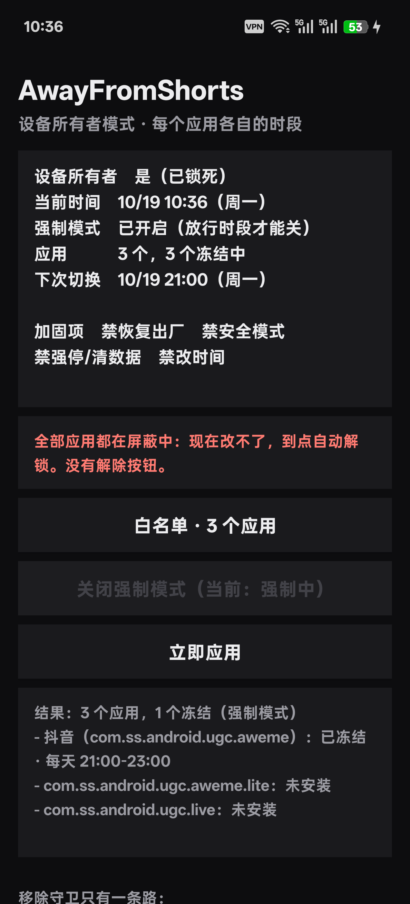
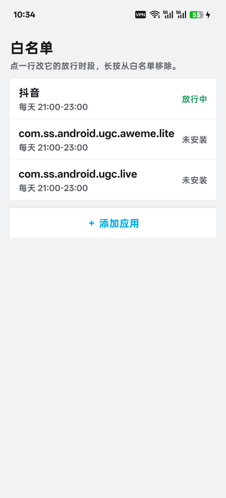

# AwayFromShorts · Android 端 📱

> 到点把短视频 App **真的锁住** —— 不是弹个提醒,是点不开。

Windows 那套(hosts 屏蔽网站 + 杀进程 + 网页面板)在 **[AwayFromShorts](https://github.com/sdgfdii/AwayFromShorts)**,
是独立的另一个仓库。这里只有安卓。

---

## 两个方案

| | **Device Owner**(`dpc/`) | **无障碍版**(`blocker/`) |
|---|---|---|
| 拦法 | 系统级冻结,图标变灰,点开提示"已暂停" | 一进前台就送回桌面 |
| 强度 | ✅ **真的锁死**:恢复出厂按钮变灰、强停/卸载点不动、安全模式进不去、改系统时间也没用 | ⚠️ 能拦,但你随时能在设置里关掉 |
| 重启后 | 照常生效 | 自动恢复 |
| 需不需要电脑 | 装的时候要,之后不要 | **完全不要** |
| 前提 | 设备必须**无账号 + 只有一个用户** | 装完即用 |

**能装 DO 就一定装 DO。** 无障碍版是退路 —— 当机器卡在"应用分身"残留的多用户上、设不上 DO 时才用它。

  

屏蔽时段整页变黑、所有控件禁用;放行时段切回浅色可编辑。应用列表单独一页,一行一个,点开改那条规则。

---

## 一、Device Owner 版(推荐)

### 一键部署

```bash
cd dpc
bash deploy.sh
```

脚本会先自检三个硬条件(**无账号 / 单用户 / 无已有 Owner**),不满足会直接告诉你卡在哪、怎么解。

装不上的机器先看 [`dpc/COMPATIBILITY.md`](dpc/COMPATIBILITY.md) —— **90% 的情况是"应用分身"留下的第二个用户**
(`Type: profile.CLONE`,user 999)。删掉克隆应用、重启都清不掉它,只能从系统 UI 里关掉分身空间或恢复出厂。
真机 PLR110(ColorOS 16 / Android 16)就踩过这个坑,恢复出厂后才设上。

**装完必须让它被叫醒**:`pm install -r` 之后 App 处于 stopped 状态,系统广播根本送不进去。
`deploy.sh` 里已经固化了 `am broadcast --include-stopped-packages -a com.afs.guard.WAKE`
这一步,并会校验闹钟真的排上了 —— 手动 `adb install` 的人别漏掉。

### 在手机上是什么样

- 首页只有一行状态 + 一个「黑名单 · N 个应用」入口 + 「立即应用」
- 黑名单页一行一个应用,点行改星期 / 多段时段(可以加好几段),长按移除
- **黑名单只进不出**:随时可以加,移出去只在「刚加 10 分钟内」或首次宽限期内允许
  —— 防的就是"先移出来再放宽时段"这条绕路

### 重构时最该看的三处

| 文件 | 说明 |
|---|---|
| `dpc/java/com/afs/guard/Guard.java` | `blocked(Rule, Calendar)` 是**唯一**判定入口;加固开关(`BLOCK_FACTORY_RESET` 等)在文件顶部 |
| `dpc/java/com/afs/guard/Rule.java` | `days` 位图 + `windows[][]`,跨午夜靠逐分钟扫 |
| `dpc/java/com/afs/guard/RuleStore.java` | 规则落在 App 私有目录,旧格式 `{d,s,e}` 自动迁移 |

---

## 二、无障碍版(不需要 DO)

```bash
cd blocker && bash build.sh          # 产物 blocker/afs-blocker.apk
# 或者直接用仓库根的 afs-blocker.apk
```

装好后在系统里开无障碍服务:

```bash
adb shell settings put secure enabled_accessibility_services com.afs.blocker/com.afs.blocker.BlockerService
adb shell settings put secure accessibility_enabled 1
```

⚠️ 三个坑:

1. `adb install -r` 会**清掉** `enabled_accessibility_services`,每次升级都要重开
2. 服务要**首次解锁后**才绑定,锁屏时查不到进程是正常的
3. 踢回桌面成功后必须把内部 `lastPkg` 置空,否则 3 秒巡检会反复按 Home(桌面被顶)

详见 [`blocker/README.md`](blocker/README.md)。

---

## 为什么这么复杂

手机上没有任何"网站屏蔽"能拦住抖音 App 本身 —— hosts / DNS 对原生 App 基本无效,
能做的只有在**系统层面**把 App 冻住。而"到点自动冻"这件事在国产 ROM 上非常难:

- **ColorOS 会把闹钟整体推后 ~3 天**(`dumpsys alarm` 里 `adjustment=+2d23h58m`,连支付宝的闹钟一样被推)
- 灭屏进 Doze 后 `Handler.postDelayed` 直接被冻住(实测灭屏 70 秒才 tick 一次)

所以 v1.8.0 之后是**四件套**一起上:

1. 双路闹钟 `setAlarmClock` + `setExactAndAllowWhileIdle`(快路径)
2. `JobScheduler` 每 15 分钟兜底
3. `GuardService` 前台常驻,30 秒 tick
4. **常驻 `PARTIAL_WAKE_LOCK`**(tag `afs:guard`,无超时)—— 灭屏 CPU 不睡,tick 才跑得准

`deploy.sh` 还会把包加进 **Doze 白名单**(`dumpsys deviceidle whitelist +com.afs.guard`)。
光有 wakelock 挡不住系统级 Doze,两个缺一不可。

> 🔋 **代价是持续耗电。** 锁不设超时,服务活着就一直持着。这是拿电量换准时 ——
> 不这么干,到点根本不动。想省电就只能接受"晚几小时才切"。

---

## 自己构建

**不用 Gradle。** 只要 SDK 里的 `build-tools`、`platforms/android-34` 和 JDK 17:

```bash
export AFS_SDK=/path/to/android-sdk
bash dpc/build.sh       # → afs-guard.apk
bash blocker/build.sh   # → blocker/afs-blocker.apk
```

手工链:`aapt2 compile → link → javac(-source 8) → jar → d8 → 塞 classes.dex → zipalign -p 4 → apksigner`。
Git Bash 里没有 `zip`,脚本会用 Python 的 `zipfile` 追加写入 dex。

签名库在 `dpc/keystore/afs.keystore`(密码 `afsguard`)。**换 key 就无法覆盖升级**,自己编译就自己生成一个并保管好。

> ⚠️ `build.sh` 内部的 `grep -v warning` 会顺手吞掉 javac 的错误。构建"成功"但 APK 只有 12KB,
> 就是编译其实失败了。装之前先验:`aapt2 dump badging afs-guard.apk | grep versionName`(正常体积 37–41KB)。

## 回归测试

```bash
bash dpc/test/run.sh        # 63 项,纯 Java,不需要手机
bash blocker/test/run.sh    # 15 项 × 2 套窗口
```

对拍的是"暴力逐分钟扫描"的结果 —— 跨午夜、多段时段、增删段的不可变性都在里面。

---

## 逃生口

```bash
cd dpc && bash uninstall.sh                                   # 正规拆除
adb shell dpm remove-active-admin com.afs.guard/.AfsAdmin      # 手拆
```

设备所有者一旦设上,**恢复出厂设置会被禁用**。这不是 bug,是 Device Owner 的本来面目。

## 还剩什么洞

诚实列一下,改代码也堵不掉:

1. **手机连着电脑就能拆** —— 一条 `dpm remove-active-admin`。数据线收起来。
2. **Web 版抖音**默认不管。要管就在 `Guard.java` 里开 `ALSO_SUSPEND_BROWSERS`。
3. **时区**:禁止手动改时间拦得住,出差自动换时区拦不住。
4. **无障碍版**天生能被用户在设置里关掉 —— 这就是它便宜的原因。

## License

[MIT](LICENSE)
